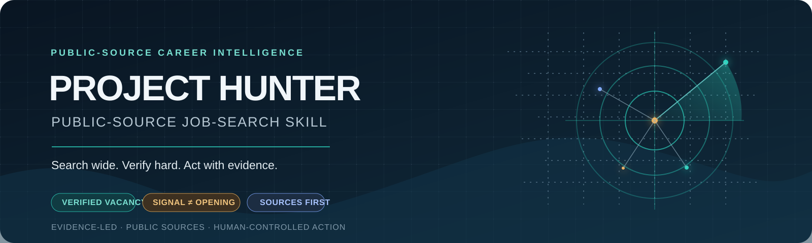

# PROJECT HUNTER

<p align="center">
  
</p>

<p align="center"><strong>SEARCH WIDE. VERIFY HARD. ACT WITH EVIDENCE.</strong></p>
<p align="center">AI skill and reference package · Public-source research · Human-controlled action</p>
<p align="center"><a href="#english">English</a> · <a href="#bahasa-indonesia">Bahasa Indonesia</a></p>

---

## English

### The mission

The Project Hunter skill guides an AI host through a traceable job-search workflow: discover relevant public sources, investigate postings and employer signals, separate verified openings from hypotheses, and give the candidate a clear next move.

**This repository is an AI skill and reference package—not a job aggregator, live vacancy database, deployed search service, scraper, browser extension, or application bot.** Live results depend on the search and page-reading tools available in the host assistant. The skill never promises exhaustive internet coverage or a job offer.

### Four intelligence lanes

| DISCOVER | INVESTIGATE | INTELLIGENCE | ACTION |
|---|---|---|---|
| Expand titles, countries, languages, and public sources | Verify employer, listing, URL, dates, and risk | Separate vacancies, leads, and hiring signals | Prioritize evidence-backed next steps; never apply or contact without specific consent |

### What is included

| File | Purpose |
|---|---|
| [`skills/project-hunter/SKILL.md`](skills/project-hunter/SKILL.md) | English operating instructions, end-to-end workflow, modes, safety rules, output gates |
| [`references/source-taxonomy.md`](skills/project-hunter/references/source-taxonomy.md) | Global, Indonesian, corporate, social, institutional, and industry source map |
| [`references/search-playbook.md`](skills/project-hunter/references/search-playbook.md) | Title expansion, query packs, multilingual search, coverage ledger |
| [`references/verification-framework.md`](skills/project-hunter/references/verification-framework.md) | V1–V5 verification, fraud-risk triage, duplicate resolution |
| [`references/scoring-model.md`](skills/project-hunter/references/scoring-model.md) | Separate opportunity-quality, candidate-match, and strategic-value scores |
| [`references/report-template.md`](skills/project-hunter/references/report-template.md) | Compact vacancy record and full intelligence-report structure |
| [`references/ethical-osint-policy.md`](skills/project-hunter/references/ethical-osint-policy.md) | Public-source boundaries, privacy, fairness, prompt-injection handling |
| [`references/tool-compatibility.md`](skills/project-hunter/references/tool-compatibility.md) | Installation, usage, capability matrix, and known limitations |
| [`evals/`](skills/project-hunter/evals/README.md) | 12 compatible evaluation-case definitions; expected outcomes are not execution results |
| [`assets/project-hunter-banner.svg`](assets/project-hunter-banner.svg) | Original, accessible project banner |

### Install

Copy the **whole** skill folder so its reference files remain available. Each command stops if its destination exists and uses `cp -n` as a no-overwrite safeguard. Inspect an existing destination before choosing an update path.

**Claude Code — project-local**

```bash
if [ -e .claude/skills/project-hunter ] || [ -L .claude/skills/project-hunter ]; then
  echo "Destination exists; inspect it before installing." >&2
  exit 1
fi
mkdir -p .claude/skills
cp -R -n skills/project-hunter .claude/skills/project-hunter
```

**OMP — user-level**

```bash
if [ -e ~/.omp/agent/skills/project-hunter ] || [ -L ~/.omp/agent/skills/project-hunter ]; then
  echo "Destination exists; inspect it before installing." >&2
  exit 1
fi
mkdir -p ~/.omp/agent/skills
cp -R -n skills/project-hunter ~/.omp/agent/skills/project-hunter
```

For other AI environments, use their documented skill directory and preserve the package structure. Reload the host if its documentation requires it to discover new skills.

### Put it to work

```text
Find Finance Manager vacancies in Jakarta posted in the last 14 days.
Prefer official career pages, show sources and active-status evidence,
and state which sources you could not access.
```

Other useful missions:

- “Check this posting’s authenticity, application URL, publication date, active status, and fraud indicators.”
- “Find public expansion signals in Indonesia; keep inferred job families separate from confirmed vacancies.”
- “Compare these roles with my CV, show the evidence and gaps, and do not submit an application.”
- “Find remote roles that explicitly accept applicants based in Indonesia.”

The skill supports the Quick Hunt, Deep Hunt, Global Hunt, Executive Hunt, Remote Hunt, Hidden Hunt, Corporate Hunt, CV Match Hunt, Industry Hunt, Verification Hunt, Fresh Job Hunt, and Strategic Career Hunt modes. Ask for only the constraints that materially change the search.

### Operating rules

- **Evidence before confidence.** A search snippet is a lead, not proof that a posting is active.
- **Signal ≠ opening.** Expansion, funding, or a new market may suggest relevant job families; none proves a vacancy without a separate posting.
- **Unknown stays unknown.** No invented salary, deadline, sponsorship, publication date, URL, source coverage, or employer.
- **Public and permitted only.** No private accounts, credential bypass, CAPTCHA circumvention, impersonation, or unauthorized scraping.
- **Candidate data stays protected.** CV matching uses role-relevant facts; no upload, forwarding, application, or recruiter contact without explicit task-specific consent.
- **Scores are not hiring odds.** Opportunity quality, candidate fit, and career value remain separate and evidence-traceable.

### Evaluation cases

The package includes 12 scenario definitions: basic search, alternative titles, global/remote eligibility, hidden signals, verification, duplicate handling, scam risk, CV matching, inaccessible sources, multilingual search, stale postings, and prompt injection. They are test inputs and expectations—not a claim that a benchmark or live search was run.

In a compatible Claude Code environment, review the CLI's current behavior and tool permissions before running:

```bash
claude plugin eval skills/project-hunter --allow-tools Read,Glob,Grep,Skill,Write,Edit,Bash
```

Model evaluation may use paid resources. Live search requires a permitted search/page-reading integration in that environment.

### Scope, limits, and contribution

Coverage is bounded by the sources and tools actually reachable in each session. Listings can be stale, duplicated, blocked, or removed after checking. Remote eligibility, work authorization, visa sponsorship, salary, and deadlines remain unconfirmed unless the source says so. The skill is guidance for an AI host; this repository does not enforce platform permissions or implement a live search system.

Improvements should preserve the evidence trail, distinguish source facts from interpretation, and update the relevant evaluation case when behavior changes. No license or production integration is asserted by this README.

---

## Bahasa Indonesia

### Misi

Skill Project Hunter memandu host AI melalui alur riset yang dapat ditelusuri: menemukan sumber publik yang relevan, memeriksa lowongan dan sinyal perusahaan, memisahkan posisi terverifikasi dari hipotesis, lalu memberi kandidat langkah berikutnya yang jelas.

**Repositori ini berisi skill AI dan materi referensi—bukan agregator lowongan, basis data lowongan aktif, layanan pencarian yang sudah berjalan, scraper, ekstensi browser, atau bot lamaran.** Hasil langsung bergantung pada tool pencarian dan pembaca halaman yang tersedia di asisten AI. Skill ini tidak menjanjikan cakupan seluruh internet atau pekerjaan.

### Empat jalur intelijen

| TEMUKAN | INVESTIGASI | INTELIJEN | TINDAKAN |
|---|---|---|---|
| Perluas jabatan, negara, bahasa, dan sumber publik | Verifikasi perusahaan, lowongan, URL, tanggal, dan risiko | Pisahkan lowongan, petunjuk, dan sinyal perekrutan | Prioritaskan langkah berbasis bukti; jangan melamar atau menghubungi tanpa persetujuan khusus |

### Isi repositori

| File | Fungsi |
|---|---|
| [`skills/project-hunter/SKILL.md`](skills/project-hunter/SKILL.md) | Instruksi operasional berbahasa Inggris, alur kerja, mode, keamanan, dan pemeriksaan kualitas |
| [`references/source-taxonomy.md`](skills/project-hunter/references/source-taxonomy.md) | Peta sumber global, Indonesia, perusahaan, sosial, institusi, dan industri |
| [`references/search-playbook.md`](skills/project-hunter/references/search-playbook.md) | Perluasan jabatan, variasi query, pencarian multibahasa, dan catatan cakupan |
| [`references/verification-framework.md`](skills/project-hunter/references/verification-framework.md) | Verifikasi V1–V5, pemeriksaan risiko penipuan, dan deduplikasi |
| [`references/scoring-model.md`](skills/project-hunter/references/scoring-model.md) | Skor kualitas lowongan, kecocokan kandidat, dan nilai strategis yang terpisah |
| [`references/report-template.md`](skills/project-hunter/references/report-template.md) | Format ringkas lowongan dan struktur laporan intelijen lengkap |
| [`references/ethical-osint-policy.md`](skills/project-hunter/references/ethical-osint-policy.md) | Batas riset sumber publik, privasi, keadilan, dan penanganan prompt injection |
| [`references/tool-compatibility.md`](skills/project-hunter/references/tool-compatibility.md) | Instalasi, penggunaan, matriks kemampuan, dan keterbatasan yang diketahui |
| [`evals/`](skills/project-hunter/evals/README.md) | 12 definisi kasus evaluasi kompatibel; hasil yang diharapkan bukan bukti pengujian |
| [`assets/project-hunter-banner.svg`](assets/project-hunter-banner.svg) | Banner proyek orisinal dan aksesibel |

### Instalasi

Salin seluruh folder skill agar file referensinya tetap tersedia. Setiap perintah berhenti jika tujuan sudah ada dan menggunakan `cp -n` sebagai pengaman agar file tidak tertimpa. Periksa tujuan yang sudah ada sebelum memilih jalur pembaruan.

**Claude Code — khusus proyek**

```bash
if [ -e .claude/skills/project-hunter ] || [ -L .claude/skills/project-hunter ]; then
  echo "Tujuan sudah ada; periksa sebelum memasang." >&2
  exit 1
fi
mkdir -p .claude/skills
cp -R -n skills/project-hunter .claude/skills/project-hunter
```

**OMP — tingkat pengguna**

```bash
if [ -e ~/.omp/agent/skills/project-hunter ] || [ -L ~/.omp/agent/skills/project-hunter ]; then
  echo "Tujuan sudah ada; periksa sebelum memasang." >&2
  exit 1
fi
mkdir -p ~/.omp/agent/skills
cp -R -n skills/project-hunter ~/.omp/agent/skills/project-hunter
```

Untuk lingkungan AI lain, gunakan direktori skill yang didokumentasikan platform dan pertahankan struktur paket. Muat ulang host jika diperlukan agar skill baru terdeteksi.

### Contoh penggunaan

```text
Carikan lowongan Finance Manager di Jakarta yang dipublikasikan
dalam 14 hari terakhir. Prioritaskan halaman karier resmi,
tampilkan sumber dan bukti status aktif, serta sebutkan sumber
yang tidak dapat diakses.
```

Contoh lain:

- “Periksa keaslian lowongan ini, URL lamaran, tanggal publikasi, status aktif, dan indikator penipuan.”
- “Cari sinyal ekspansi publik di Indonesia; pisahkan keluarga jabatan yang diperkirakan dari lowongan terkonfirmasi.”
- “Bandingkan posisi ini dengan CV saya, tunjukkan bukti dan kekurangannya, dan jangan kirim lamaran.”
- “Cari pekerjaan remote yang secara eksplisit menerima pelamar dari Indonesia.”

Mode yang tersedia: Quick Hunt, Deep Hunt, Global Hunt, Executive Hunt, Remote Hunt, Hidden Hunt, Corporate Hunt, CV Match Hunt, Industry Hunt, Verification Hunt, Fresh Job Hunt, dan Strategic Career Hunt. Skill hanya perlu meminta batasan yang benar-benar mengubah pencarian.

### Aturan kerja

- **Bukti lebih dulu.** Cuplikan hasil pencarian adalah petunjuk, bukan bukti lowongan masih aktif.
- **Sinyal bukan lowongan.** Ekspansi, pendanaan, atau pasar baru dapat mengisyaratkan keluarga jabatan, tetapi tidak membuktikan lowongan tanpa posting terpisah.
- **Yang tidak diketahui tetap tidak diketahui.** Jangan mengarang gaji, tenggat, sponsor visa, tanggal, URL, cakupan sumber, atau perusahaan.
- **Hanya sumber publik dan akses yang diizinkan.** Tidak ada akun privat, bypass kredensial, CAPTCHA, penyamaran identitas, atau scraping tanpa izin.
- **Data kandidat tetap terlindungi.** Pencocokan CV menggunakan fakta yang relevan; tidak ada unggah, penerusan, pengiriman lamaran, atau kontak perekrut tanpa persetujuan khusus.
- **Skor bukan peluang diterima.** Kualitas lowongan, kecocokan kandidat, dan nilai karier tetap terpisah serta dapat ditelusuri ke bukti.

### Kasus evaluasi

Paket ini memuat 12 definisi skenario: pencarian dasar, variasi jabatan, kelayakan global/remote, sinyal tersembunyi, verifikasi, duplikasi, risiko penipuan, pencocokan CV, sumber tidak tersedia, pencarian multibahasa, lowongan lama, dan prompt injection. File tersebut adalah masukan serta ekspektasi pengujian—bukan klaim bahwa benchmark atau pencarian langsung telah dijalankan.

Pada lingkungan Claude Code yang kompatibel, periksa perilaku CLI dan izin tool terlebih dahulu:

```bash
claude plugin eval skills/project-hunter --allow-tools Read,Glob,Grep,Skill,Write,Edit,Bash
```

Evaluasi model dapat memakai sumber daya berbayar. Pencarian langsung memerlukan integrasi pencarian/pembaca halaman yang diizinkan di lingkungan tersebut.

### Cakupan, batasan, dan kontribusi

Cakupan dibatasi oleh sumber dan tool yang benar-benar dapat diakses pada setiap sesi. Lowongan dapat kedaluwarsa, terduplikasi, diblokir, atau dihapus setelah diperiksa. Kelayakan kerja remote, izin kerja, sponsor visa, gaji, dan tenggat tetap belum terkonfirmasi kecuali dinyatakan sumber. Skill ini merupakan panduan untuk host AI; repositori ini tidak menegakkan izin platform dan tidak mengimplementasikan sistem pencarian langsung.

Perbaikan sebaiknya mempertahankan jejak bukti, membedakan fakta sumber dari interpretasi, dan memperbarui kasus evaluasi yang relevan saat perilaku berubah. README ini tidak menyatakan adanya lisensi atau integrasi produksi.
